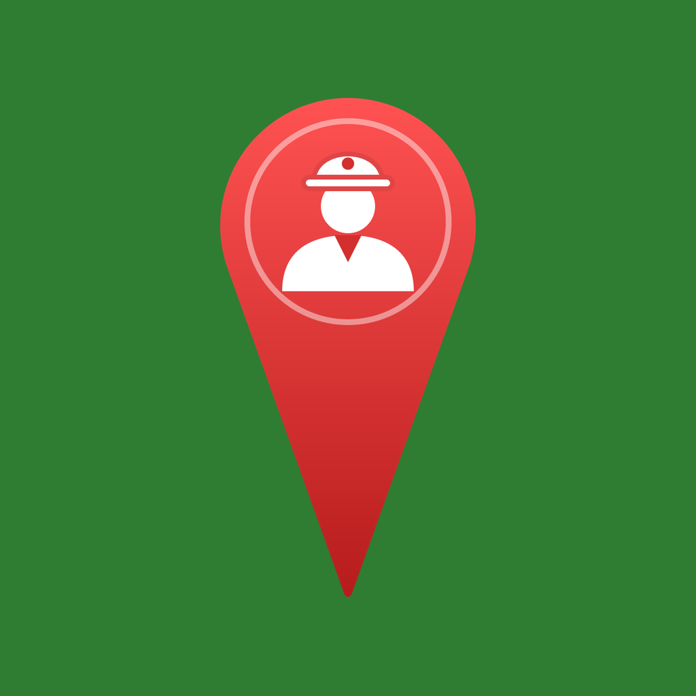

<p align="center">
  
</p>

<h1 align="center">tala</h1>

<p align="center">
  <strong>Signaler sur le terrain les problèmes urbains, et suivre leur traitement</strong><br>
  l'application des collecteurs et des administrateurs de la plateforme UrbaSign
</p>

<p align="center">
  
  
  
  
</p>

---

**tala** est l'application de **collecte** de la plateforme **UrbaSign** (projet *Signalement des problèmes urbains*).

| Brique | Rôle |
| ------ | ---- |
| **API UrbaSign** (Laravel) | stocke les comptes, les signalements et les photos |
| **tala** (cette app) | les **collecteurs** créent les signalements ; les **administrateurs** les traitent et gèrent les collecteurs |
| **mono** | les habitants consultent les signalements sur une carte |

Une seule application pour deux rôles : après la connexion, tala affiche les écrans du collecteur **ou** ceux de l'administrateur, selon le rôle renvoyé par l'API.

## Sommaire

- [Fonctionnalités](#fonctionnalités)
- [Captures d'écran](#captures-décran)
- [Couleurs](#couleurs)
- [Prérequis](#prérequis)
- [Installation et lancement](#installation-et-lancement)
- [Comptes de test](#comptes-de-test)
- [Architecture](#architecture)
- [GetX dans le projet](#getx-dans-le-projet)
- [Sécurité](#sécurité)
- [Stockage dans le téléphone](#stockage-dans-le-téléphone)
- [Écrans et routes](#écrans-et-routes)
- [Routes de l'API utilisées](#routes-de-lapi-utilisées)
- [Packages](#packages)
- [Icône de l'application](#icône-de-lapplication)
- [Générer l'APK](#générer-lapk)

## Fonctionnalités

**Pour tout le monde**
- Connexion par e-mail et mot de passe. La session est gardée : pas besoin de se reconnecter à chaque ouverture.
- Le dernier e-mail utilisé est pré-rempli.
- Page **Profil** :
  - Mon contenu : raccourcis vers les autres onglets ;
  - Compte : notifications (accepter / refuser) et modifier mes informations ;
  - Informations : aide, conditions d'utilisation, politique de confidentialité, partager l'application (collecteur) ;
  - Se déconnecter.
- E-mails toujours **masqués** à l'écran (`a***n@user.com`).
- Thème clair, sombre ou automatique.

**Collecteur** : ⚠️ Mes signalements · ➕ Ajouter · 👤 Profil
- **Créer un signalement en moins d'une minute** :
  - photo prise avec l'appareil, compressée automatiquement sous 1 Mo ;
  - position GPS trouvée toute seule à l'ouverture du formulaire, avec sa précision (« ±12 m ») ;
  - **ajustement à la main** sur une carte si le GPS est imprécis : on fait glisser la carte sous une épingle fixe ;
  - catégorie et gravité choisies en un appui (puces de couleur) ;
  - quartier avec recherche, pré-rempli avec le dernier utilisé ;
  - description de 200 caractères maximum, avec compteur.
- Barre de progression pendant l'envoi de la photo (« Envoyer… 45 % »).
- Messages clairs en cas d'échec (pas de réseau, photo trop lourde, champ manquant). Le formulaire est **gardé** pour réessayer.
- **Mes signalements** : liste avec photo, catégorie, statut et date, filtrable par statut, puis page de détail.

**Administrateur** : ⚠️ Signalements · 👤+ Ajouter · 👥 Collecteurs · 👤 Profil
- **Tous les signalements**, filtrables par catégorie et par statut, avec le total.
- Page de détail avec **changement de statut** (Signalé → En cours → Résolu) et **suppression**.
- **Ajouter un collecteur** (nom, prénom, e-mail, mot de passe).
- **Liste des collecteurs** avec une recherche et le **nombre de signalements sur l'avatar** de chacun.
- Page d'un collecteur : ses informations et **ses** signalements, suppression du compte.

**Confort**
- Navigation **adaptative** : barre en bas sur téléphone, sur le côté sur ordinateur (≥ 1024 px).
- Listes en 1 à 4 colonnes et formulaires en 2 colonnes sur grand écran.
- Écrans prévus de 150 px de large jusqu'au plein écran d'un ordinateur.
- Mode hors ligne en lecture : les listes déjà reçues restent affichées.
- Interface entièrement en français.

## Captures d'écran

| Connexion | Mes signalements | Ajouter | Signalements (admin) | Profil |
| :-------: | :--------------: | :-----: | :------------------: | :----: |
|  |  |  |  |  |

## Couleurs

Même palette que mono, pour que les deux applications de la plateforme se ressemblent. Seul le fond de l'icône change : **vert** pour tala, orange pour mono.

| Couleur | Rôle | Thème clair | Thème sombre |
| ------- | ---- | ----------- | ------------ |
| Vert    | boutons, composants, pastilles de compteur | `#2E7D32` | `#81C784` |
| Jaune   | barre du haut, navigation | `#F9A825` | `#FFF176` |
| Rouge   | erreurs, suppression | `#C62828` | `#EF9A9A` |
| Fond    | arrière-plan | blanc `#FFFFFF` | noir `#000000` |

Catégories : Voirie `#E65100` · Ordures `#795548` · Éclairage public `#7B1FA2` · Caniveau/Inondation `#1565C0` · Autre `#546E7A`.

## Prérequis

- **Flutter 3.44** ou plus récent, avec **Dart 3.12.2** ou plus (`flutter --version`)
- VS Code ou Android Studio
- Un téléphone Android (recommandé : appareil photo et GPS), un émulateur ou Windows
- **L'API UrbaSign lancée** (dossier `api-laravel-urbasign`, voir son README)

## Installation et lancement

### 1. Récupérer le projet

```bash
git clone -b urbacollector https://github.com/LEBAMBA-Brandon/UrbaSign.git tala
cd tala
flutter pub get
```

### 2. Lancer l'API

Dans le dossier de l'API :

```bash
php artisan migrate:fresh --seed
php artisan serve --host=0.0.0.0 --port=8000
```

> `--host=0.0.0.0` est indispensable pour un vrai téléphone : sans lui, l'API n'accepte que les requêtes du PC.

### 3. Lancer l'application

| Appareil | Commande | Adresse de l'API |
| -------- | -------- | ---------------- |
| Émulateur Android | `flutter run` | `http://10.0.2.2:8000/api` (automatique) |
| Windows | `flutter run -d windows` | `http://localhost:8000/api` (automatique) |
| Vrai téléphone | `flutter run --dart-define=API_URL=http://IP_DU_PC:8000/api` | celle que tu donnes |

Pour un vrai téléphone : même Wi-Fi que le PC, IP du PC avec `ipconfig` (ligne « Adresse IPv4 »).

Avec VS Code, dans `.vscode/launch.json` :

```json
{
  "name": "tala (téléphone)",
  "cwd": "tala",
  "program": "lib/main.dart",
  "request": "launch",
  "type": "dart",
  "toolArgs": ["--dart-define=API_URL=http://192.168.1.71:8000/api"]
}
```

## Comptes de test

- **Administrateur** : le compte `admin@user.com` créé par le seeder de l'API.
- **Collecteur** : connecte-toi en administrateur, puis crée un collecteur dans l'onglet **Ajouter**.

## Architecture

Code rangé en **trois couches**, comme mono. Chaque couche ne parle qu'à celle du dessous.

```
lib/
├── main.dart                 démarrage : GetStorage, thème, GetMaterialApp
├── core/                     ce qui sert partout
│   ├── theme/                couleurs, thèmes, tailles, icônes, formats, infos de l'app
│   └── widget/               composants réutilisables (champs, puces, cartes, navigation…)
├── data/                     les données, sans aucun widget
│   ├── models/               Utilisateur, Session, Signalement, NouveauSignalement…
│   ├── services/             API (dio + token), GetStorage, SharedPreferences, GPS, photo
│   └── repositories/         session, cache, mode hors ligne, vérifications
└── module/                   les écrans et leur logique
    ├── routes/               noms des routes + pages
    ├── binding/              création des controllers
    ├── controller/           état des écrans (.obs) et actions
    ├── middleware/           connecté ? admin ? id valide ?
    └── screens/              connexion, accueil, collecteur, admin, profil, détails
```

```
Écran ──(Obx)──▶ Controller ──▶ Repository ──▶ Service ──▶ API UrbaSign / téléphone
```

## GetX dans le projet

| Notion | Utilisation dans tala |
| ------ | --------------------- |
| `GetMiddleware` (`priority`) | `AuthMiddleware` (connecté ?), `AdminMiddleware` (admin ?), `IdValideMiddleware` (`/signalement/abc` → page introuvable) |
| `Bindings` + `Get.lazyPut` | les controllers des onglets ne sont créés qu'à leur première ouverture : un collecteur ne crée jamais les controllers admin |
| `Get.put(..., permanent: true)` | services et repositories vivent toute la durée de l'app (session, caches) |
| `ever` | les listes se relisent quand on revient sur leur onglet |
| `debounce` | recherche de collecteurs |
| `Get.toNamed<T>` / `Get.back(result:)` | la carte « ajuster la position » renvoie la position choisie au formulaire |
| `GetxController` : `onInit` / `onReady` / `onClose` | `onInit` crée les champs, `onReady` lance le GPS, `onClose` libère tout et annule les requêtes |

## Sécurité

- **Token Sanctum** envoyé automatiquement par un intercepteur dio (`Authorization: Bearer …`).
- **Session expirée** (401) : déconnexion automatique et retour à l'écran de connexion.
- **Déconnexion** : le token est supprimé côté serveur, et les caches sont vidés (un autre collecteur sur le même téléphone ne voit rien du précédent).
- Aucun mot de passe ni token dans les logs (`LogInterceptor` sans corps ni en-têtes).
- E-mails masqués à l'écran.
- Les droits réels sont vérifiés par l'API (`can:admin`) ; les middlewares de l'app ne font que guider l'utilisateur.

## Stockage dans le téléphone

| Outil | Ce qu'il garde | Pourquoi lui |
| ----- | -------------- | ------------ |
| **GetStorage** | session (token + profil), thème, choix des notifications | lecture **sans `await`** : le middleware sait tout de suite si quelqu'un est connecté |
| **SharedPreferences** | dernier e-mail, dernier quartier | pré-remplir les formulaires |

> En production, le token devrait aller dans `flutter_secure_storage` (stockage chiffré).

## Écrans et routes

| Route | Écran | Gardes |
| ----- | ----- | ------ |
| `/connexion` | Connexion | déjà connecté → accueil |
| `/accueil` | Onglets (selon le rôle) | connecté |
| `/signalement/:id` | Détail d'un signalement | connecté, id valide |
| `/collecteur/:id` | Détail d'un collecteur | connecté, admin, id valide |
| `/choix-position` | Carte pour ajuster la position | connecté |
| `/profil/modifier` | Modifier mes informations | connecté |
| `/info/:page` | Aide, conditions, confidentialité | — |
| `/introuvable` | Page introuvable | — |

## Routes de l'API utilisées

| Requête | Utilisation |
| ------- | ----------- |
| `POST /api/auth/login` | connexion |
| `GET /api/auth/me` | vérifier la session au démarrage |
| `PATCH /api/auth/profil` | modifier mes informations |
| `POST /api/auth/logout` | déconnexion |
| `POST /api/signalements` (multipart) | créer un signalement avec sa photo |
| `GET /api/signalements/mes-signalements` | liste du collecteur |
| `GET /api/signalements?categorie=…&statut=…` | liste de l'admin |
| `GET /api/signalements/{id}` | détail |
| `PATCH /api/signalements/{id}/statut` | changer le statut (admin) |
| `DELETE /api/signalements/{id}` | supprimer (admin) |
| `GET / POST / DELETE /api/users` | collecteurs (admin) |
| `GET /api/quartiers` | liste du formulaire |

## Packages

| Package | Rôle |
| ------- | ---- |
| `get` | état, navigation, dépendances, thème |
| `dio` | requêtes HTTP, envoi multipart avec progression |
| `get_storage` / `shared_preferences` | stockage local |
| `geolocator` | position GPS et sa précision |
| `image_picker` | photo (appareil ou galerie), compression |
| `flutter_map` + `latlong2` | cartes OpenStreetMap |
| `share_plus` | partager l'application |
| `flutter_localizations` | interface système en français |

## Icône de l'application

Images dans `assets/images/` : `icone_app.png` (fond vert) et `icone_app_premier_plan.png` (épingle seule, pour l'icône adaptative Android).

Dans `pubspec.yaml` :

```yaml
dev_dependencies:
  flutter_launcher_icons: ^0.14.4

flutter_launcher_icons:
  android: true
  ios: true
  remove_alpha_ios: true          # iOS refuse les icônes transparentes
  image_path: "assets/images/icone_app.png"
  adaptive_icon_background: "#35833d"
  adaptive_icon_foreground: "assets/images/icone_app_premier_plan.png"
  min_sdk_android: 21
  web:
    generate: true
    image_path: "assets/images/icone_app.png"
    background_color: "#35833d"
    theme_color: "#35833d"
```

Puis :

```bash
flutter pub get
dart run flutter_launcher_icons
```

## Générer l'APK

```bash
flutter build apk --release --dart-define=API_URL=http://IP_OU_DOMAINE:8000/api
```

Le fichier est dans `build/app/outputs/flutter-apk/app-release.apk`.

> L'adresse de l'API est figée dans l'APK au moment du build : refais l'APK si l'adresse change.
